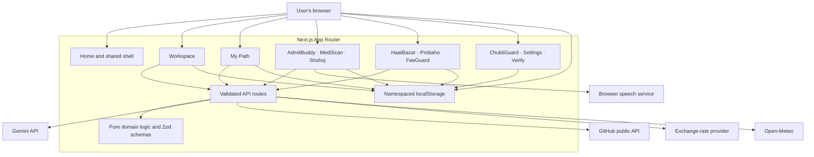

# Architecture map

## Current system

## Request and trust boundaries

| Flow | Payload crosses boundary when | Server/provider | Local persistence |
|---|---|---|---|
| Auditor | User starts audit with CV text/file | KormoPath route; Gemini for model extraction; GitHub public API if username supplied/detected | Results are in workspace browser state; do not represent as remote account storage |
| Viva | User submits answer for grading | KormoPath route; Gemini when configured, deterministic fallback otherwise | User progress can persist locally |
| Client pitch | User asks to draft a pitch | KormoPath route; Gemini, with schema/amount checks | User retains draft in browser flow |
| Receipt OCR | User uploads/selects receipt | KormoPath route; Gemini vision | Receipt history/ledger local |
| Buddy | User submits chat | KormoPath route; Gemini; no local app storage is read | Chat is current browser state; no server DB |
| Product/opportunity/agriculture search | User submits search query | KormoPath route; Gemini Search grounding | Saved links/quotes local, query/results shown to user |
| MediScan OCR | User checks explicit consent and submits image | KormoPath route; Gemini vision | Local only if user separately saves the result |
| FX/weather | Page requests current public data | Exchange provider / Open-Meteo via KormoPath | No sensitive user data needed; responses may be cached |
| Voice input | User starts speech recognition in compatible browser | Browser/vendor-dependent recognition service | Transcript is handled by the app after browser returns it |
| Passport signing | User issues/submits a passport | KormoPath API signs/validates token; no database | Token is held by the user and share URL is bearer-like |

## Absent infrastructure

There is no database schema, migration system, identity provider, roles, server session, hosted notification queue or file store. All app data groups are browser-local. Any future account/sync work requires explicit product decisions about data residency, consent, authentication, account deletion, backup, key management, access control and health-data handling. Do not add client-only role checks and call them authorization.

## Proposed extension seam (no backend chosen)

Keep current `lib/<domain>.ts` deterministic modules and namespaced persistence. For future remote adapters, define typed domain ports (`ProfileRepository`, `ReminderScheduler`, `CredentialIssuer`) and local implementations first. Add remote implementations only after the owner chooses an identity/database provider and data-handling policy. Preserve app-local namespaces and explicit sharing boundaries; MediScan data must never be included by a generic cross-app exporter/dashboard without separate consent.
