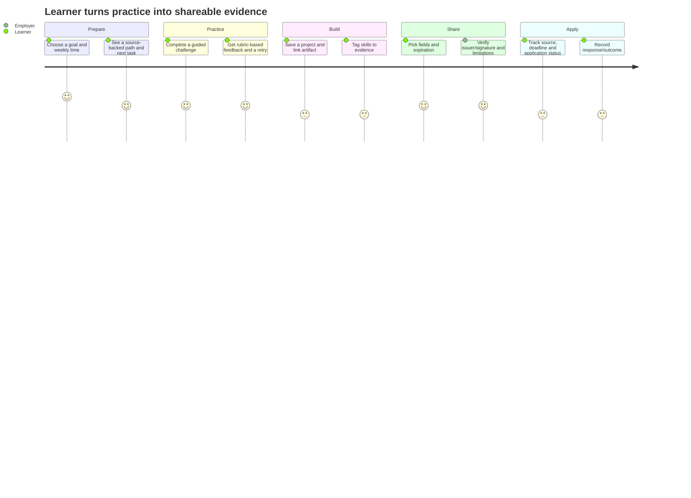

# User journey map

## Current journeys

| Person and goal | Current path | Outcome / friction |
|---|---|---|
| Freelancer seeks work | `/workspace`: audit CV → challenge/viva → passport → pitch/client terms → payout math; My Path searches public opportunities | Strong differentiator: evidence and deterministic finance. Friction: no persistent application CRM, hosted portfolio or employer review; cross-device continuity is absent. |
| Student prepares for admission | `/admitbuddy`: enter profile → shortlist → checklist/tasks → circular/source → SOP draft → calendar export | Practical, no guessed deadline. Friction: user must maintain dates and visit official sites manually. |
| Farmer compares crop sale/logistics | `/haatbazar`: local/distant price → total trip costs → weather → personal price/transport quotes | Useful offline arithmetic. Friction: quote data is self-entered; no verified supplier or booking network. |
| Household tracks money | `/shohoj-budget`: enter/speak/SMS → review draft → confirm → analyze/export | Good confirmation/privacy. Friction: no account recovery or bank/MFS sync. |
| Patient reads prescription | `/mediscan`: type or consented OCR → inspect transcription → interpret printed details/flags → optionally save locally | Safety-aware. Friction: incomplete reference data and pending pharmacist review. |
| Speaker practices interview | `/probaho`: choose track → answer by typing/speech → review score → repeat | Local progress and transparent rubric. Friction: finite bank; no structured mistake-review queue yet. |

## Cross-platform friction

1. Each app explains its local data separately; a consistent action-level data disclosure should appear before every external send.
2. Opportunity saved links and application actions are separate from user outcome tracking. A future “saved → applied → response/outcome” pipeline can remain local first.
3. Skill proof does not yet automatically package a portfolio of user projects. Evidence should be user-authored and clearly distinguished from independently assessed evidence.
4. There is no central notification inbox. Calendars and in-app status are safer first steps than silent background push or a new account backend.
5. App interfaces are primarily Bengali with English terms; a real language preference and translation QA are still needed beyond the home toggle.

## Target journey: practice to credible work sample

## Target journey: farm quote decision

Search or enter seller quote → date/location/product unit and delivery conditions are visible → compare only like-for-like quotes → calculate landed cost from user-supplied numbers → contact seller/driver to reconfirm → optionally record booking/order status. No platform checkout or seller trust badge until verified supplier identity and operational support exist.
